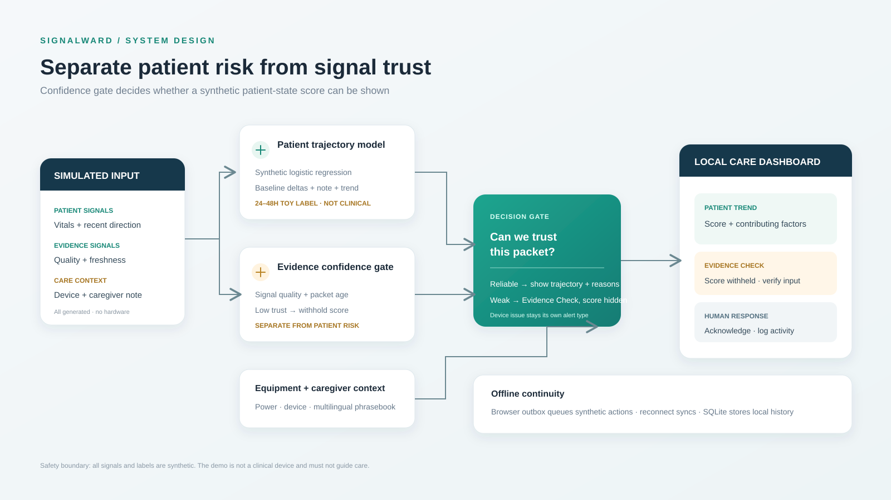

# SignalWard

### Confidence-aware home-care digital twin | Team Radhe

SignalWard is a hardware-free, local-first prototype that demonstrates how a home-care monitoring workflow can distinguish a patient-pattern signal from an unreliable measurement. Its key behavior is simple: **when the simulated evidence is noisy or stale, withhold the patient-state score and request an evidence check.**

> **Simulation only.** All readings, profiles, notes, equipment conditions, signal-quality values, and model outputs are synthetic. The model is not clinically validated and must never be used to diagnose, forecast a real patient's condition, or guide treatment.

## Why SignalWard

A single abnormal reading can reflect a change in the patient, a poor measurement, old data, or an equipment issue. SignalWard keeps those possibilities separate so the demo can show not only what it flags, but also how much trust it places in the incoming evidence.



## What the prototype demonstrates

- **Sensor simulation:** Stable, Watch, Noisy Sensor, Escalation, and Power Backup scenarios; no hardware required.
- **Confidence-aware review:** a separate signal-quality and freshness gate can withhold the patient score and raise an Evidence Check.
- **Explainable toy model:** generated examples produce an illustrative trend tier and feature reasons when the evidence gate passes.
- **Device context:** connection and backup-power state stay separate from patient physiology.
- **Caregiver workflow:** alert acknowledgement, demo attendance logging, and fixed phrasebook notes in English, Hindi, Spanish, and Tamil.
- **Resilience demo:** a browser `localStorage` outbox queues actions during simulated offline mode and syncs after reconnection.
- **Local-only design:** Python standard library, SQLite, HTML, CSS, and vanilla JavaScript; no cloud APIs or package installation.

## Run locally

**Requirement:** Python 3.10 or newer.

### Windows

```powershell
py -3 server.py
```

### macOS or Linux

```bash
python3 server.py
```

Then open [http://127.0.0.1:8765](http://127.0.0.1:8765). Use demo code `2468` for attendance logging. Stop the server with `Ctrl+C`.

## Three-minute demo path

1. Select **Stable** and point out the synthetic sensor packet and evidence confidence.
2. Select **Noisy Sensor**. Show that an alarming-looking value with poor signal quality creates an Evidence Check and withholds the patient score.
3. Select **Watch** to show clean synthetic drift and its explanation.
4. Add a phrasebook note and inspect the original text and English equivalent.
5. Select **Escalation**, acknowledge the alert, and point out the separate equipment condition.
6. Toggle simulated offline mode, queue an action, reconnect, and show it sync.

See [`DEMO_SCRIPT.md`](DEMO_SCRIPT.md) for narration and timing.

## Project map

```text
.
├── server.py                 # Local JSON API, simulator, and SQLite persistence
├── risk_model.py             # Generated-data logistic model and evidence gate
├── index.html                # Dashboard structure
├── styles.css                # Responsive UI styling
├── app.js                    # Dashboard behavior and offline queue
├── architecture.svg          # System architecture diagram
├── TECHNICAL.md              # Architecture, data flow, safeguards, and evaluation
├── DEMO_SCRIPT.md            # Three-minute presentation script
└── docs/
    ├── PROJECT_PROPOSAL.md   # Idea submission
    └── SignalWard_Project_Proposal_Team_Radhe.pdf
```

## Reset local demo data

Stop the server, remove `data/signalward.sqlite3`, and clear the browser's local storage for this site. The app creates a fresh synthetic baseline at startup.

## Known limitations

This is a hackathon prototype, not a clinical product. The signal-quality input is itself simulated and does not establish sensor accuracy. The phrasebook is a fixed set of example phrases, not a general translation service. The demo code does not verify identity or physical presence. Offline sync is a simple store-and-forward demonstration, not a guaranteed delivery protocol. The server binds to localhost and is not designed for internet exposure. There is no real sensor, identity provider, external notification channel, or clinician-approved threshold.

## Team

**Team name:** Radhe  
**Project:** SignalWard — Confidence-Aware Home-Care Digital Twin

## Safety references

- [FDA: Pulse Oximeters](https://www.fda.gov/medical-devices/products-and-medical-procedures/pulse-oximeters)
- [eCQI Resource Center: Clinical Decision Support](https://ecqi.healthit.gov/cds/about)
