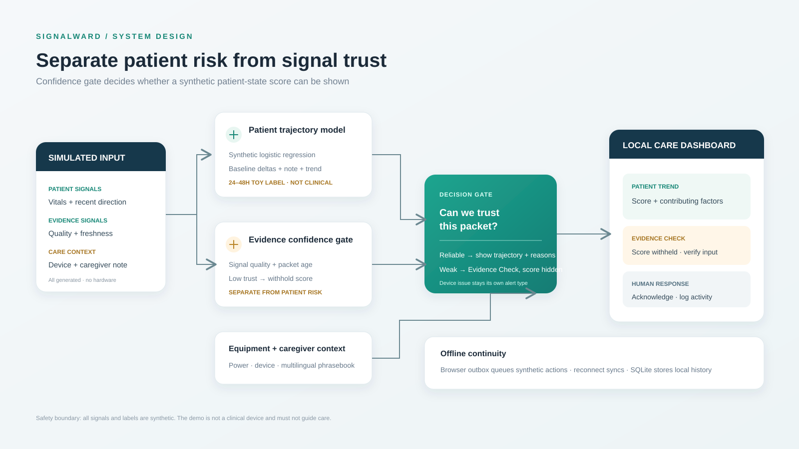

# SignalWard technical documentation

## 1. Core design: two tracks, one review

SignalWard maintains two distinct outputs for every synthetic packet:

1. **Patient trajectory:** an explainable logistic-regression score trained on generated examples, using deviations from the synthetic baseline, recent direction, and a caregiver phrasebook flag.
2. **Evidence confidence:** signal-quality percentage and packet freshness. If confidence is below the configured demo gate, the patient score is withheld and the event is classified as `evidence_check`.

Equipment connection and backup battery are a third, separate context track. Equipment faults can raise a device review or accompany a patient-trend review, but they are not treated as patient physiology. The purpose is to demonstrate safer separation of concerns; the synthetic confidence value does not establish real sensor accuracy.

## 2. Architecture

The dashboard uses same-origin JSON calls to a local Python standard-library HTTP server. The server generates simulator packets, scores them, and writes readings, notes, alerts, and attendance events to SQLite. The browser draws trends and maintains a localStorage outbox while its simulated offline mode is enabled.

```text
Mock sensor packet
  ├─ vitals + configured demo baseline ─▶ synthetic patient trajectory model
  ├─ signal quality + freshness ───────▶ evidence confidence gate
  └─ equipment + power state ──────────▶ device context
                    │                         │
                    └──── classify event ◀───┘
                              │
             ┌────────────────┼─────────────────┐
             ▼                ▼                 ▼
        patient trend    evidence check     equipment review
             └────────────────┼─────────────────┘
                              ▼
              dashboard + reason list + human acknowledgement

Offline browser actions ─▶ localStorage queue ─▶ sync on reconnect
```



## 3. Components

### Browser dashboard

- `index.html` contains the care-twin overview and controls.
- `styles.css` provides the responsive visual system.
- `app.js` polls `/api/state`, renders current values and the trend chart, and buffers synthetic actions while offline mode is simulated.
- The panel separately displays patient-score state and evidence confidence. An Evidence Check shows `WITHHELD`, rather than displaying the internal toy model value.

### API and data

- `server.py` uses `ThreadingHTTPServer` and SQLite; no external packages are needed.
- Tables: `readings` (including telemetry quality), `notes`, `alerts` (including alert kind), `attendance`.
- `GET /api/state` returns the synthetic baseline, readings, telemetry, risk classification, alerts, notes, and visit events.
- `POST /api/simulate` accepts `stable`, `watch`, `artifact`, `escalation`, or `backup`.
- `POST /api/notes` stores a fixed multilingual phrase and its English equivalent.
- `POST /api/attendance` checks a demo code and records an activity.
- `POST /api/alerts/{id}/ack` records an acknowledgement.

## 4. Dual-track model

`risk_model.py` fits a small logistic regression at process startup on 2,400 deterministic synthetic examples. A generated teacher function creates the demonstration labels. The label `synthetic_escalation_pattern_24_48h` is only a toy target. No real or clinical training data is used.

Patient features are pulse difference, oxygen reading decrease, breathing-rate increase, temperature increase, systolic-pressure difference, phrasebook concern flag, and recent direction. The model returns an internal probability and feature reasons. A separate evidence gate computes demo confidence from `signal_quality_pct` and `age_seconds`.

- At demo confidence **55% or higher**, the interface may show the synthetic patient score and tier.
- Below **55%**, the score is withheld and an Evidence Check alert is raised.
- A disconnected equipment feed or very low simulated backup battery creates equipment context independently of patient score.

These cutoffs and features are only for a visible prototype. They are not medical thresholds, validated data-quality requirements, or a real 24–48-hour forecast.

## 5. Scenario design

- **Stable:** near-baseline synthetic values and high demo signal quality.
- **Watch:** clean signal with moderate, consistent synthetic changes.
- **Noisy sensor (`artifact` API value):** a visibly unusual value paired with poor signal quality. It should produce an Evidence Check and hide the patient score.
- **Escalation:** larger multi-signal synthetic changes with a disconnected equipment state and backup-power context.
- **Power Backup:** near-baseline patient values with a backup supply state.

The “Noisy sensor” counterexample is the key innovation demo: the system distinguishes “concerning value” from “trustworthy evidence.”

## 6. Multilingual note handling

English, Hindi, Spanish, and Tamil sample phrases map to fixed English equivalents. The original and equivalent are shown together. There is no open-ended translation or external language model. The phrasebook feature is a workflow demonstration, not a validated clinical translation service.

## 7. Resilience and privacy

- The offline switch is simulated; the browser displays the last server state and stores demo actions locally until reconnect.
- Backup power is simulated device telemetry; the host computer remains powered during the demo.
- The server binds to `127.0.0.1`; the app makes no cloud calls.
- Never enter real patient data. There is no real identity verification, external messaging, authentication provider, or production security configuration.
- Offline delivery is a prototype store-and-forward queue, not a guaranteed exactly-once synchronization protocol.

## 8. Evaluation plan

Use only the built-in scenarios. Confirm that noisy packets route to Evidence Check and the UI withholds the patient score; stable packets remain low; clean drift can show an explainable synthetic flag; equipment disruption appears as a distinct context; caregiver acknowledgement is logged; and offline events sync after reconnect. These checks demonstrate software behavior only, not clinical performance or health outcomes.

## 9. Safety context

The FDA notes that pulse oximeters have limitations and can be inaccurate in some circumstances. Clinical decision support is intended to support, not replace, clinician judgment. See [FDA pulse oximeter overview](https://www.fda.gov/medical-devices/products-and-medical-procedures/pulse-oximeters) and [eCQI clinical decision support overview](https://ecqi.healthit.gov/cds/about). SignalWard’s model is only a synthetic systems demo and must never guide care.
